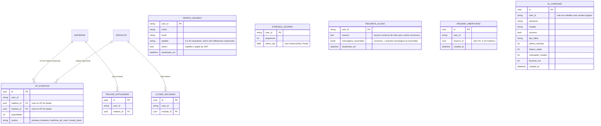

# Modelo de dados — tabelas que faltam no ER do README

O ER da seção 3 do `README.md` cobre 15 das tabelas do banco. Este documento descreve as que foram criadas depois
(Sprint 3). Como no resto do serviço, `user_id` vem da claim `userId` do JWT (string tipo `cuid`) e **não há tabela
de usuários**.

## O que cada tabela guarda

| Tabela | Para quê | Regras principais |
|---|---|---|
| `xp_eventos` | Cada ganho de XP do aluno. O XP total e o ranking são a soma dos eventos. | `motivo` é um de `primeira_tentativa`, `melhoria_de_nota` ou `streak_diario`. O XP do streak não pertence a matéria nem módulo. |
| `perfis_usuario` | Espelho mínimo dos dados do authSys, atualizado a cada requisição autenticada a partir do JWT. É a fonte do nome, do apelido e do papel. | O ranking mostra só o `apelido` (sem apelido, "Aluno" + código curto). Administradores (`admin = true`) não entram no ranking. |
| `streaks_usuario` | Dias seguidos de estudo de cada aluno. | Um dia conta quando o aluno conclui ao menos um questionário (treino incluso); abrir o app não conta. Passou um dia inteiro sem estudar, a sequência zera. Dia = fuso `America/Sao_Paulo`. |
| `resumos_aluno` | Resumo contínuo do histórico de conversas do aluno, usado como contexto do chat no lugar do histórico inteiro. | Um por aluno. Atualizado em segundo plano a cada 10 mensagens novas, um aluno por vez. Se a IA falhar, o resumo anterior é mantido. |
| `resumo_aberturas` | Cada vez que o aluno abre um resumo de estudo na Biblioteca (US18). | Reabrir conta de novo; baixar o PDF não conta. O total aparece em `GET /progresso` (`resumos_revisados`). |
| `ia_consumo` | Uma linha por chamada ao provedor de IA (cada nova tentativa automática é uma linha, pois é cobrada). | Alimenta `GET /ia/consumo` (só admin), com total, por funcionalidade, por usuário e por dia ou hora. |
| `licoes_iniciadas` | Marca que o aluno já recebeu a lição do módulo, para não repetir a explicação nem reenviar à IA. | Única por (aluno, módulo). |
| `trilhas_estudando` | Quais matérias o aluno está estudando na sua trilha. | Única por (aluno, matéria). |

## Migrations relacionadas

`0018` `ia_consumo` · `0021` `resumos_aluno` · `0022` `streaks_usuario` e XP do streak · `0023` apelido em
`perfis_usuario` · `0024` `perfis_usuario.admin` · `0025` `resumo_aberturas`.
